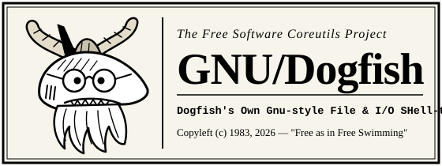

<div align="center">
  
</div>

---

> *"I'd just like to interject for a moment. What you are referring to as 'Coreutils', is in fact, **GNU/Dogfish**, or as I've recently taken to calling it, **GNU plus Dogfish**. Coreutils is not an operating system unto itself, but rather another free component of a fully functioning POSIX system made useful by the GNU/Dogfish SIMD byte kernels, NDJSON object pipelines, and reversible transaction journals comprising a full OS as defined by POSIX."*
> — **St. Ignucius of the Spiny Dogfish**

---

## 📜 The GNU/Dogfish Manifesto

In 1983, Richard Stallman announced the **GNU Project** to give computer users freedom—specifically, the freedom to inspect, modify, and share the foundational utilities of their operating system.

For forty years, `ls`, `cat`, `wc`, `cp`, `df`, and `sort` have stood as the bedrock of free computing. Yet somewhere along the way, userland utilities stagnated in the constraints of 1970s teletypes:
- Piping `ls` into `sort` required fragile whitespace-splitting hacks (`awk`, `cut -d' '`).
- Copying a 50 GiB file meant grinding spinning rust (or NVMe cells) instead of invoking modern Copy-on-Write (`clonefile` / `FICLONE`) filesystem primitives.
- Accidentally typing `rm -rf` meant irreversible catastrophe with no journaled rollback.
- Every command ran in complete silence with zero visibility into kernel strategy, memory bandwidth, or execution latency.

**GNU/Dogfish** is our love letter to the Free Software movement, forged in **100% safe, libre Rust**:
1. **Uncompromising User Freedom**: No telemetry servers, no proprietary blobs, no cloud lock-in, ever. When you pass `--stats`, the telemetry belongs **exclusively to you on your local `stderr`**.
2. **Respect for Your Hardware**: Free software should not waste your CPU cycles. Every millisecond saved by SIMD vector scans (`memchr`, `bytecount`), memory-mapped I/O (`mmap`), work-stealing parallelism (`rayon`, `jwalk`), and zero-copy kernel clones (`clonefile`) returns power and time to the user.
3. **Structured Freedom in the Shell**: Text streams are universal, but **JSON Lines (NDJSON)** are self-describing. GNU/Dogfish utilities speak both fluently.

---

## 🗽 The Four Essential Freedoms

GNU/Dogfish is Free Software (*"free" as in freedom, not merely "free beer"—though it is also gratis*):

- **Freedom 0**: The freedom to run `dogfish` for any purpose, on any machine, at memory-bandwidth speeds.
- **Freedom 1**: The freedom to study how `dogfish-core` maps files into virtual memory and change it to suit your computing needs.
- **Freedom 2**: The freedom to redistribute copies of `dogfish` so you can help your neighbor escape slow, non-reversible utilities.
- **Freedom 3**: The freedom to distribute copies of your modified versions to others, advancing the state of the art of Libre Systems Programming.

---

## ⚡ Benchmarks vs. Legacy Coreutils

Every copy of `dogfish` ships with a built-in head-to-head benchmark suite (`dogfish bench`) so you can verify its claims on your own hardware at any time:

```text
$ dogfish bench
⚡ dogfish bench: Generating 32 MiB synthetic benchmark corpus...

 BENCHMARK         DOGFISH   SYSTEM       SPEEDUP  RELATIVE    ENGINE STRATEGY           
 ────────────────────────────────────────────────────────────────────────────────────────
 wc -l (32 MiB)     5.30ms  33.01ms  6.23x faster  [████████]  mmap + SIMD bytecount     
 cp (32 MiB file)   3.01ms  27.83ms  9.25x faster  [████████]  APFS clonefile (CoW)      
 sort -r (32 MiB)  30.65ms  54.34ms  1.77x faster  [███░░░░░]  rayon par_sort_by         
 wc -lwc (32 MiB)  25.09ms  47.85ms  1.91x faster  [███░░░░░]  mmap + single-pass scanner
 md5sum (32 MiB)   45.17ms  53.59ms  1.19x faster  [██░░░░░░]  mmap + Rust md-5          
```

---

## 🔥 The 5 Killer Innovations

### 1. Adaptive NDJSON Object Pipelines + Auto-Table Rendering
Pipe structured objects between standard Unix commands in `bash`, `zsh`, or `fish`—and let the final command automatically render a colorized terminal table when `stdout` is a TTY:

```bash
dogfish ls -J crates/dogfish/src \
  | dogfish sort --by size --desc \
  | dogfish cut -f name,size,kind,modified_relative \
  | dogfish head -n 5
```
Output:
```text
 name       size  kind  modified_relative
 ────────────────────────────────────────
 fs_ops.rs  31.2 KiB  file  4m ago           
 text.rs    28.7 KiB  file  2m ago           
 sys.rs     19.4 KiB  file  8m ago           
 meta.rs    12.1 KiB  file  1m ago           
 hash.rs    11.0 KiB  file  7m ago           
```

### 2. Global `--stats` Local Telemetry
Append `--stats` to **any** Dogfish utility to inspect wall-clock execution time, I/O throughput, item counts, and the active kernel/SIMD strategy:

```text
$ dogfish ls --tree -L 2 --stats
.
├── Cargo.lock
├── Cargo.toml
├── PLAN.md
├── README.md
├── assets/
│   └── dogfish-logo.svg
└── crates/
    ├── dogfish/
    └── dogfish-core/
[⚡ dogfish ls 471.83µs │ items: 9 │ engine: recursive visual tree renderer]
```

### 3. Reversible File Operations (`rm --safe`, `mv`, `cp` + `dogfish undo`)
Mistakes shouldn't be fatal. Dogfish maintains a local transaction journal (`~/.dogfish/journal.json` and `~/.dogfish/trash`):

```bash
$ dogfish rm --safe -v secret_notes.txt
trashed 'secret_notes.txt' (undo id #1: run `dogfish undo` to restore)

$ dogfish undo
✔ Undone: [id #1, tool: rm] Restored '/path/to/secret_notes.txt' from trash
```

### 4. Rich Visual Cards & Unicode Sparklines (`df`, `du`, `stat`, `wc --table`)
```text
$ dogfish stat Cargo.toml
  File: Cargo.toml  (regular file)
  Size: 841 B (841 B)   Blocks: 8   Inode: 193703651
Access: -rw-r--r-- (0644)   Owner: oddurs:staff (501:20)   Links: 1
Modify: 2026-10-23 23:47:31 -0400 (15m ago)
Access: 2026-10-23 23:47:44 -0400
Change: 2026-10-23 23:47:31 -0400
```

### 5. Single Multicall Binary + 40 Symlink Personalities
Like BusyBox, `dogfish` compiles into a single stripped, LTO-optimized binary that dispatches either via subcommand (`dogfish ls`) or `argv[0]` symlink (`ls -> dogfish` or `df-ls -> dogfish`).

---

## 🧰 All 45 Libre Utilities

| Category | Utilities | Highlights |
| :--- | :--- | :--- |
| **File & Directory** (12) | `ls`, `cp`, `mv`, `rm`, `mkdir`, `ln`, `chmod`, `chown`, `stat`, `touch`, `df`, `du` | APFS `clonefile` CoW in `cp`; parallel `jwalk` in `du`; `--tree` & `-J` in `ls`; sparkline bars in `df`/`du`; visual card in `stat`; `--safe` trash in `rm`. |
| **Text & Streaming** (10) | `cat`, `head`, `tail`, `wc`, `sort`, `uniq`, `cut`, `tr`, `paste`, `nl` | SIMD `bytecount`/`memchr`; NDJSON `--by <field>` in `sort`/`uniq`; field projection in `cut -f`; reverse `SeekFrom::End` in `tail`. |
| **Hashing & Encoding** (5) | `b2sum`, `sha256sum`, `md5sum`, `base64`, `basenc` | Multi-threaded `rayon` file hashing; `-c` (`--check`) verifier; `base64url`, `base32`, `base16`/`hex`, `base2`/`bin` in `basenc`. |
| **Shell & System** (13) | `echo`, `printf`, `env`, `id`, `uname`, `whoami`, `yes`, `true`, `false`, `sleep`, `seq`, `date`, `tee` | 64 KiB page-aligned vector output in `yes`; human durations (`500ms`, `1m30s`) in `sleep`; `--table` and `-J` in `env`. |
| **Meta-Tools** (5) | `bench`, `undo`, `history`, `init`, `install-links` | Head-to-head benchmark suite, undo journal rollback, shell integration generator (`zsh`, `bash`, `fish`), and symlink installer. |

---

## 🚀 Installation & Shell Integration

### Build from Source
```bash
git clone https://github.com/oddurs/dogfish.git
cd dogfish
cargo build --release
```

### Option A: Instant Shell Integration (`fish`, `zsh`, `bash`)
```fish
# In Fish (~/.config/fish/config.fish):
/path/to/dogfish/target/release/dogfish init fish --safe-rm | source
```
```bash
# In Zsh (~/.zshrc) or Bash (~/.bashrc):
eval "$(/path/to/dogfish/target/release/dogfish init zsh --safe-rm)"
```

### Option B: BusyBox-Style Symlinks
```bash
# Drop-in symlinks (ls, cp, mv, cat, wc, df, du...):
./target/release/dogfish install-links ~/.local/bin

# Or prefixed symlinks (df-ls, df-cp, df-cat...):
./target/release/dogfish install-links ~/.local/bin --prefix df-
```

---

## ⚖️ License & Copyleft Notice

Copyright © 2026 The GNU/Dogfish Contributors.
Distributed as **Free and Open Source Software** under the dual **GPL-3.0-or-later / MIT** license.

*"Share and enjoy! Happy hacking!"* — 🦈🦬
