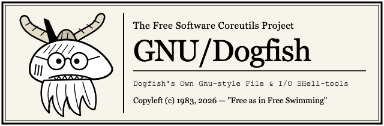

[](https://github.com/oddurs/gnu-dogfish/actions/workflows/ci.yml)
[](https://github.com/oddurs/gnu-dogfish/releases)
[](./LICENSE)
[](https://github.com/oddurs/gnu-dogfish)
[](#all-57-libre-utilities)

---

> *"I'd just like to interject for a moment. What you are referring to as 'Coreutils', is in fact, **GNU/Dogfish**, or as I've recently taken to calling it, **GNU plus Dogfish**. Coreutils is not an operating system unto itself, but rather another free component of a fully functioning POSIX system made useful by the GNU/Dogfish SIMD byte kernels, NDJSON object pipelines, and reversible transaction journals comprising a full OS as defined by POSIX."*
> — **St. Ignucius of the Spiny Dogfish**

---

## 📜 The GNU/Dogfish Manifesto

In 1983, Richard Stallman announced the **GNU Project** to give computer users freedom—specifically, the freedom to inspect, modify, and share the foundational utilities of their operating system.

For forty years, `ls`, `cat`, `wc`, `cp`, `df`, and `sort` have stood as the bedrock of free computing. Yet somewhere along the way, userland utilities stagnated in the constraints of 1970s teletypes:
- Piping `ls` into `sort` required fragile whitespace-splitting hacks (`awk`, `cut -d' '`).
- Copying a 50 GiB file meant grinding spinning rust (or NVMe cells) instead of invoking modern Copy-on-Write (`clonefile` / `FICLONE`) filesystem primitives.
- Accidentally typing `rm -rf` meant irreversible catastrophe with no journaled rollback.
- Every command ran in complete silence with zero visibility into kernel strategy, memory bandwidth, or execution latency.

**GNU/Dogfish** is our love letter to the Free Software movement, forged in **libre Rust** (safe Rust everywhere except a small set of audited `libc` FFI calls — see [SECURITY.md](./SECURITY.md)):
1. **Uncompromising User Freedom**: No telemetry servers, no proprietary blobs, no cloud lock-in, ever. When you pass `--stats`, the telemetry belongs **exclusively to you on your local `stderr`**.
2. **Respect for Your Hardware**: Free software should not waste your CPU cycles. Every millisecond saved by SIMD vector scans (`memchr`, `bytecount`), memory-mapped I/O (`mmap`), work-stealing parallelism (`rayon`, `jwalk`), and zero-copy kernel clones (`clonefile`) returns power and time to the user.
3. **Structured Freedom in the Shell**: Text streams are universal, but **JSON Lines (NDJSON)** are self-describing. GNU/Dogfish utilities speak both fluently.

---

## 🗽 The Four Essential Freedoms

GNU/Dogfish is Free Software (*"free" as in freedom, not merely "free beer"—though it is also gratis*):

- **Freedom 0**: The freedom to run `dogfish` for any purpose, on any machine, at memory-bandwidth speeds.
- **Freedom 1**: The freedom to study how `dogfish-core` maps files into virtual memory and change it to suit your computing needs.
- **Freedom 2**: The freedom to redistribute copies of `dogfish` so you can help your neighbor escape slow, non-reversible utilities.
- **Freedom 3**: The freedom to distribute copies of your modified versions to others, advancing the state of the art of Libre Systems Programming.

---

## ⚡ Benchmarks vs. GNU Coreutils

Every copy of `dogfish` ships with a head-to-head benchmark suite (`dogfish bench`) so you can check these claims on your own hardware:

```text
$ dogfish bench -n 9 -s 32
 BENCHMARK            DOGFISH    SYSTEM        SPEEDUP  ENGINE STRATEGY
 ──────────────────────────────────────────────────────────────────────────────────
 wc -l (32 MiB)        5.90ms    7.92ms   1.34x faster  mmap + SIMD bytecount
 cp (32 MiB file)     18.26ms   26.47ms   1.45x faster  FICLONE / copy_file_range
 sort -r (32 MiB)     63.39ms   75.33ms   1.19x faster  rayon par_sort_by
 wc -lwc (32 MiB)     23.24ms  528.12ms  22.72x faster  mmap + single-pass scanner
 md5sum (32 MiB)      55.56ms   57.69ms   1.04x faster  mmap + ASM md-5
 sha256sum (32 MiB)   99.44ms   94.80ms          0.95x  mmap + ring SHA-256 (OpenSSL asm)
 seq 1 1,000,000       9.51ms    7.99ms          0.84x  itoa + 64KiB BufWriter
```

**How this was measured:** best of 9 runs, warm page cache, GNU coreutils 9.4 on Ubuntu 24.04, a 4-core Intel Xeon @ 2.8 GHz VM (no SHA extensions), and the portable release build (no `target-cpu=native`). Each run includes process startup (~2 ms for both). What the numbers mean:

- **Where dogfish wins:** memory-mapped scanning, parallel sorting, and copying straight into a new file. The `wc -lwc` gap mostly reflects GNU 9.4's slow byte-at-a-time word counting; the outputs are identical.
- **Where it doesn't:** SHA-256 runs on the same OpenSSL assembly GNU reaches through libcrypto, so it is a wash. `seq` is within startup noise.
- **What `cp` costs when it overwrites:** dogfish keeps the old contents so `dogfish undo` can restore them, which makes overwriting slower than GNU. Set `DOGFISH_UNDO=off` to skip that.

Results vary by OS, filesystem, CPU and file size. Run `dogfish bench` yourself before relying on any figure.

---

## 🔥 The 5 Killer Innovations

### 1. Adaptive NDJSON Object Pipelines + `dogfish query` + Auto-Table Rendering
Pipe structured objects between standard Unix commands in `bash`, `zsh`, or `fish`—and filter, sort, or project them using either standard commands (`sort --by`, `cut -f`, `head -n`) or the dedicated **`dogfish query`** SQL-like engine:

```bash
# Single-stage SQL-like query on `ls -J` output:
dogfish ls -J crates/dogfish/src/tools \
  | dogfish query --where "size>10K" --where type=file --sort size --desc --select name,size,mtime

# Or compose standard Unix tools with NDJSON flags:
dogfish ls -J crates/dogfish/src/tools \
  | dogfish sort --where "size>1K" --by size --desc \
  | dogfish cut -f name,size,mtime \
  | dogfish head -n 3 -J
```
Output (the records; on a terminal without `-J`, the same as a table):
```text
{"name":"sort.rs","size":92311,"mtime":"2026-10-29T18:03:19.123456789Z"}
{"name":"cp.rs","size":81734,"mtime":"2026-10-29T17:58:02.004718233Z"}
{"name":"du.rs","size":49528,"mtime":"2026-10-29T18:01:44.981027611Z"}
```

Every `-J` record follows one contract, described in **[doc/ndjson.md](./doc/ndjson.md)**: one compact JSON object per line, streamed as produced; sizes and counts as integers; times as RFC 3339 UTC strings with nanoseconds plus an integer `*_ns` twin; modes in octal and symbolic form; names as received, with a base64 `*_bytes` twin when they are not UTF-8; the same field names in every tool. Each tool's records have a versioned JSON Schema in [`doc/schema/`](./doc/schema/) (`dogfish schema ls` prints one), and the compatibility policy is that fields may be added, while removing, renaming or retyping one needs a new version (`--json=2`).

```console
$ dogfish seq -J 2
{"value":1}
{"value":2}
$ dogfish id -J
{"uid":1000,"user":"ada","gid":1000,"group":"ada","euid":1000,"egid":1000,"groups":[{"gid":1000,"name":"ada"}]}
$ dogfish du -a -J src | dogfish query -w "size>8K" -s size -d -n 1
{"path":"src","size":1265664,"files":143}
$ dogfish cp -rJ src missing backup | dogfish query -w 'action == copy' -n 2
cp: cannot stat 'missing': No such file or directory
{"action":"copy","source":"src","dest":"backup","type":"directory","undo_id":7}
{"action":"copy","source":"src/main.rs","dest":"backup/main.rs","type":"file","bytes":14897,"undo_id":7}
```

The tools that change files (`cp`, `mv`, `rm`, `mkdir`, `ln`, `chmod`, `chown`, `touch`, `mktemp`, `tee`, `dogfish undo`, `dogfish install-links`) write one record per action with `-J`, the structured form of `-v`, and with `-J` every diagnostic is also an `{"error":...,"path":...,"errno":...}` record, in order with the others; standard error stays GNU's. Byte filters (`cat`, `tr`, `tac`, `nl`, `paste`, `base64`, ...) have no `-J`: their output is the data ([doc/ndjson.md](./doc/ndjson.md#tools-without-records)).

### 2. Global `--stats` Local Telemetry
Append `--stats` to any Dogfish utility (or set `DOGFISH_STATS=1`; `echo`, `printf`, `true`, `false` and `yes` take their arguments as GNU does, so only the variable works there) to inspect wall-clock execution time, I/O throughput, item counts, and the active kernel/SIMD strategy:

```text
$ dogfish ls --tree -L 2 --stats
.
├── Cargo.lock
├── Cargo.toml
├── PLAN.md
├── README.md
├── assets/
│   └── dogfish-logo.svg
└── crates/
    ├── dogfish/
    └── dogfish-core/
[⚡ dogfish ls 471.83µs │ items: 9 │ engine: recursive visual tree renderer]
```

### 3. Reversible File Operations (`rm --safe`, `mv`, `cp` + `dogfish undo`)
Mistakes shouldn't be fatal. Dogfish maintains a local transaction journal (`~/.dogfish/journal.ndjson` and `~/.dogfish/trash`, or `$DOGFISH_HOME`). When `cp` or `mv` overwrite a file, the previous version is kept so `undo` can bring it back:

```bash
$ dogfish rm --safe -v secret_notes.txt
trashed 'secret_notes.txt' (undo id #1: run `dogfish undo` to restore)

$ dogfish undo
✔ Undone: [id #1, tool: rm] Restored '/path/to/secret_notes.txt' from trash
```

Retention is bounded so the trash cannot grow forever:

| Setting | Default | Meaning |
| :--- | :--- | :--- |
| `DOGFISH_JOURNAL_MAX` | `500` | Operations kept for `undo`. Older entries — and anything they hold in the trash, including `rm --safe` files — are deleted. |
| `DOGFISH_BACKUP_LIMIT` | `1G` | Total size of the automatic backups `cp`/`mv` keep of files they overwrite. Oldest backups are discarded first; the newest is always kept. `rm --safe` files never count against it. |
| `DOGFISH_UNDO` | on | Set to `off` to stop `cp`/`mv` recording undo entries and keeping backups of what they overwrite (overwrites then cost what GNU's do, and can't be undone). `rm --safe` still uses the trash. |

`undo` never overwrites a file that has reappeared at a path it would restore, and an `undo` whose backup was discarded leaves the current file in place rather than deleting it. Operations are journaled before they start, so even a `cp`, `mv` or `rm --safe` killed half-way can be undone; files on other file systems go to a trash on that file system (`.dogfish-trash-<uid>-…` at its top), so trashing is a rename that keeps hard links. The guarantees are listed in [SECURITY.md](SECURITY.md#undo-and-the-trash).

### 4. Rich Visual Cards & Unicode Sparklines (`df`, `du`, `stat`, `wc --table`)
```text
$ dogfish stat Cargo.toml
  File: Cargo.toml  (regular file)
  Size: 841 B (841 B)   Blocks: 8   Inode: 193703651
Access: -rw-r--r-- (0644)   Owner: oddurs:staff (501:20)   Links: 1
Modify: 2026-10-23 23:47:31 -0400 (15m ago)
Access: 2026-10-23 23:47:44 -0400
Change: 2026-10-23 23:47:31 -0400
```

### 5. Single Multicall Binary + 52 Symlink Personalities
Like BusyBox, `dogfish` compiles into a single stripped, LTO-optimized binary that dispatches either via subcommand (`dogfish ls`) or `argv[0]` symlink (`ls -> dogfish` or `df-ls -> dogfish`).

### GNU compatibility

When output goes to a pipe or a file, Dogfish behaves like GNU coreutils 9.4 byte for byte for the options it implements: the same output, error messages and exit codes. When output goes to a terminal, the visual tools (`ls`, `df`, `du`, `stat`, `wc --table`, ...) switch to their rich tables and sparklines. `-J/--json` always emits NDJSON records ([doc/ndjson.md](./doc/ndjson.md)) for `dogfish query` pipelines; without it, output is GNU's.

This is checked on every Linux CI run by a differential suite of more than 1,800 cases, which runs each command through both Dogfish and GNU in identical fixture trees and compares the results (`crates/dogfish/tests/gnu_compat*.rs`).

GNU's own test suite is the harder bar. `util/gnu-tests.sh` runs coreutils 9.4's tests against Dogfish (only the tests whose programs under test Dogfish implements all of); CI runs it nightly and fails if a test in [`util/gnu-baseline.json`](./util/gnu-baseline.json) stops passing. **Today all 378 such tests that run pass (39 more skip in CI's environment).** The tests that fail were filed as cairn items (0025–0056) and fixed; the skips need root, ACLs, a second group or similar. Known gaps are listed in [ROADMAP.md](./ROADMAP.md), and planned work is tracked as [cairn](https://github.com/oddurs/cairn) items in [`cairn/items`](./cairn/items). Main ones: collation in non-C locales (Dogfish sorts and compares bytes as in `LC_ALL=C`) and a handful of rarely used flags.

---

## 🧰 All 57 Libre Utilities

| Category | Utilities | Highlights |
| :--- | :--- | :--- |
| **File & Directory** (16) | `ls`, `cp`, `mv`, `rm`, `mkdir`, `ln`, `chmod`, `chown`, `stat`, `touch`, `df`, `du`, `realpath`, `basename`, `dirname`, `mktemp` | APFS `clonefile` CoW in `cp`; parallel `jwalk` in `du`; `--tree` & `-J` in `ls`; sparkline bars in `df`/`du`; visual card in `stat`; `--safe` trash in `rm`. |
| **Text & Streaming** (13) | `cat`, `tac`, `head`, `tail`, `wc`, `sort`, `uniq`, `cut`, `tr`, `paste`, `nl`, `shuf`, `query` | SIMD `bytecount`/`memchr`; SQL-like NDJSON `query` (`-w`, `-s`, `-f`, `-n`); `--where` & `--by <field>` in `sort`; reverse SIMD `tac`; Fisher-Yates `shuf`. |
| **Hashing & Encoding** (5) | `b2sum`, `sha256sum`, `md5sum`, `base64`, `basenc` | Multi-threaded `rayon` file hashing; `-c` (`--check`) verifier; `base64url`, `base32`, `base16`/`hex`, `base2`/`bin` in `basenc`. |
| **Shell & System** (18) | `echo`, `printf`, `env`, `printenv`, `id`, `uname`, `hostname`, `nproc`, `whoami`, `yes`, `true`, `false`, `sleep`, `timeout`, `watch`, `seq`, `date`, `tee` | 64 KiB page-aligned vector output in `yes`; human durations (`500ms`, `1m30s`) in `sleep`, `timeout`, and `watch`; `--table` and `-J` in `env`. |
| **Meta-Tools** (5) | `bench`, `undo`, `history`, `init`, `install-links` | Head-to-head benchmark suite, undo journal rollback, shell integration generator (`zsh`, `bash`, `fish`), and symlink installer. |

---

## 🚀 Installation & Shell Integration

### Prebuilt Binaries

Linux (x86_64) and macOS (arm64) archives are on the [Releases page](https://github.com/oddurs/gnu-dogfish/releases), with `SHA256SUMS`, an SBOM, and signed build provenance. Check them before use:

```bash
sha256sum -c --ignore-missing SHA256SUMS
gh attestation verify gnu-dogfish-linux-x86_64.tar.gz --repo oddurs/gnu-dogfish
```

[doc/verify.md](doc/verify.md) covers the details, including rebuilding a release bit for bit.

Each archive holds the `dogfish` binary and a `share/` tree: manual pages (`dogfish.1`, and `dogfish-ls.1` and so on for each utility) and completions for bash, zsh and fish. To install under `~/.local`:

```bash
mkdir -p ~/.local/bin ~/.local/share && tar xzf gnu-dogfish-linux-x86_64.tar.gz -C /tmp
install -m 755 /tmp/dogfish ~/.local/bin/
cp -R /tmp/share/. ~/.local/share/
man dogfish-ls
```

- **man** finds `~/.local/share/man` when `~/.local/bin` is on `PATH` (or add it to `MANPATH`).
- **bash** (with bash-completion) loads `~/.local/share/bash-completion/completions/dogfish` when you complete `dogfish`. For the links `install-links` makes (`ls`, `df-ls`), source that file from `~/.bashrc`: it completes every link that resolves to the dogfish binary.
- **zsh**: `fpath=(~/.local/share/zsh/site-functions $fpath)` before `compinit`. `df-*` links complete on their own; for links named after the tools, add `compdef _dogfish ls cp mv` (and so on). Aliases from `dogfish init` complete as `dogfish TOOL`.
- **fish** loads `~/.local/share/fish/vendor_completions.d/dogfish.fish` when you complete `dogfish`; source it from `config.fish` to complete `df-*` links and links that resolve to dogfish from the start.

A source build writes the same tree with `cargo xtask docs-gen` (into `target/docs-gen/share`). The pages and completions are generated from each tool's option table and `--help` text, so they list exactly what the parser accepts.

### Build from Source
```bash
git clone https://github.com/oddurs/gnu-dogfish.git
cd gnu-dogfish
cargo build --release
```

The default build targets your architecture's baseline CPU so binaries are portable. For a build tuned to the machine you're on (and the fastest benchmark numbers), opt in explicitly:

```bash
RUSTFLAGS="-C target-cpu=native" cargo build --release
```

### Option A: Instant Shell Integration (`fish`, `zsh`, `bash`)
```fish
# In Fish (~/.config/fish/config.fish):
/path/to/dogfish/target/release/dogfish init fish --safe-rm | source
```
```bash
# In Zsh (~/.zshrc) or Bash (~/.bashrc):
eval "$(/path/to/dogfish/target/release/dogfish init zsh --safe-rm)"
```

### Option B: BusyBox-Style Symlinks

Symlinks named after the tools shadow your system coreutils for anything that puts `~/.local/bin` first on `PATH`. That includes scripts. Read the compatibility notes above first, or use a prefix.

```bash
# Drop-in symlinks (ls, cp, mv, cat, wc, df, du...):
./target/release/dogfish install-links ~/.local/bin

# Or prefixed symlinks (df-ls, df-cp, df-cat...):
./target/release/dogfish install-links ~/.local/bin --prefix df-
```

---

## ⚖️ License, Copyleft & Trademark Notice

Copyright © 2026 The GNU/Dogfish Contributors.
Distributed as **Free and Open Source Software** under the dual **GPL-3.0-or-later OR MIT** license ([LICENSE](./LICENSE)).

See [CONTRIBUTING.md](./CONTRIBUTING.md), [CHANGELOG.md](./CHANGELOG.md), [SECURITY.md](./SECURITY.md), and [CODE_OF_CONDUCT.md](./CODE_OF_CONDUCT.md) for community and security guidelines.

*Note: GNU/Dogfish is an independent Free Software project inspired by the GNU Project and is not affiliated with or endorsed by the Free Software Foundation.*

*"Share and enjoy! Happy hacking!"* — 🦈🦬
